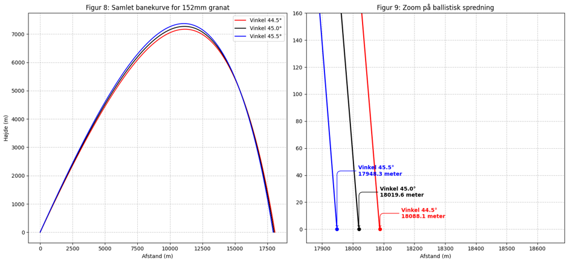

# Artillery Trajectory & Ballistics Simulation

A Python-based simulation created for my high school thesis project (SRP) modeling the physics, air resistance, and trajectory of 152mm artillery shells.

## Overview
This repository contains a numerical physics simulation designed to calculate and visualize projectile motion under realistic atmospheric conditions. The project investigates ballistic precision and the impact of marginal variations in firing angles.

## Key Features
* **Physics & Drag Modeling:** Computes trajectory taking gravity, air density, caliber, and drag coefficients ($C_d$) into account.
* **Numerical Integration (Euler Method):** Iteratively updates velocity and position step-by-step using discrete time intervals ($\Delta t$).
* **Data Visualization:** Plots complete trajectories and zoomed-in ballistic dispersion using `matplotlib`.

## Trajectory Plots

### Samlet banekurve & ballistisk spredning

## Tech Stack
* **Language:** Python
* **Libraries:** `math`, `matplotlib`

---
*Created as part of the student portfolio by Asad Sultanov (DTU Software Technology).*
